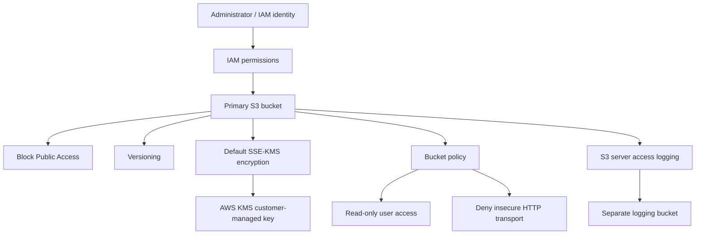

# AWS S3 Security Hardening

A hands-on AWS cloud security project demonstrating how to secure an Amazon S3 bucket through public access restrictions, versioning, SSE-KMS encryption, IAM-based access control, server access logging, and HTTPS enforcement.

> **Difficulty:** Beginner to Intermediate  
> **Platform:** Amazon Web Services (AWS)  
> **Primary services:** Amazon S3, AWS IAM, AWS KMS

---

## 1. Project Overview

Amazon S3 is a scalable object storage service. Misconfigured buckets and overly permissive access policies can expose data to unauthorized users or create opportunities for data loss.

This project applies multiple layers of security to an S3 bucket and validates the configurations using the AWS Management Console and AWS CLI.

### Objectives

- Create an S3 bucket with Block Public Access enabled.
- Enable bucket versioning to retain previous object versions.
- Configure default server-side encryption using AWS KMS (SSE-KMS).
- Restrict bucket access through IAM permissions and an S3 bucket policy.
- Configure S3 server access logging to a separate destination bucket.
- Enforce HTTPS by denying requests that do not use secure transport.

## 2. Project Scope and Completion

The project currently covers the following six exercises:

| Exercise | Implementation | Status |
|---|---|---|
| 1. Create and secure an S3 bucket | Created bucket; enabled all four Block Public Access settings | Completed |
| 2. Enable bucket versioning | Enabled versioning and used a test object to validate object versioning | Completed |
| 3. Configure SSE-KMS | Configured default bucket encryption with a customer-managed KMS key | Completed |
| 4. Configure IAM and bucket access | Added a bucket policy granting the designated read-only IAM user `s3:ListBucket` and `s3:GetObject` | Completed |
| 5. Configure server access logging | Configured a separate destination bucket and the `s3-access-logs/` prefix | Completed |
| 6. Enforce HTTPS | Added a bucket-policy Deny statement for requests where `aws:SecureTransport` is `false` | Completed |

Exercises involving upload-encryption enforcement, multi-identity permission testing, CloudTrail data events, and broader security assessment are outside the current project scope.

## 3. AWS Architecture

### Components

| Component | Purpose |
|---|---|
| Primary S3 bucket | Stores the lab test objects |
| S3 Block Public Access | Helps prevent accidental public exposure |
| S3 Versioning | Retains multiple versions of objects |
| AWS KMS customer-managed key | Protects objects using SSE-KMS |
| AWS IAM | Defines the identity and permissions used to access the bucket |
| S3 bucket policy | Grants the specified read-only user access and denies insecure transport |
| S3 logging destination bucket | Receives server access log files |

### Logical architecture



## 4. Implementation Summary

### Exercise 1 – Create and secure the S3 bucket

**Objective:** Create the primary S3 bucket and establish its initial security settings.

**Configuration:**
- Object Ownership: Bucket owner enforced.
- Block Public Access: All four settings enabled.
- Bucket Versioning: Enabled in Exercise 2.
- Default Encryption: Configured as SSE-KMS in Exercise 3.

**Validation:** Reviewed the bucket's creation, Permissions, and Properties pages in the AWS Management Console.

### Exercise 2 – Enable bucket versioning

**Objective:** Preserve previous versions of objects when an object is overwritten or deleted.

**Implementation:**
1. Enabled Bucket Versioning in the bucket's Properties.
2. Uploaded a test object named `test.txt`.
3. Used the same object key for a subsequent upload.
4. Checked the object's versions using the S3 console's **Show versions** option.

**Security benefit:** Versioning provides a recovery point for accidental overwrites and some accidental deletion scenarios. It is not a substitute for a separate backup strategy.

### Exercise 3 – Configure SSE-KMS encryption

**Objective:** Protect stored objects using server-side encryption with AWS KMS.

**Implementation:**
1. Created a customer-managed symmetric KMS key.
2. Created an alias for the key.
3. Configured the S3 bucket's default encryption to use SSE-KMS and the selected KMS key.
4. Checked the bucket's default encryption configuration.

**Security benefit:** SSE-KMS integrates object encryption with AWS KMS key management and access controls.

**Considerations:** KMS key policies and IAM permissions must allow the relevant operations. KMS usage may incur additional charges. Keep the key in the same AWS Region as the S3 bucket.

### Exercise 4 – Configure IAM and bucket access

**Objective:** Grant the designated IAM user read-only access to the S3 bucket.

The bucket policy contains an `AllowReadOnlyUser` statement for the IAM user `S3-ReadOnly-User`, with these actions:

- `s3:ListBucket` on the bucket.
- `s3:GetObject` on objects in the bucket.

**Security benefit:** The policy demonstrates resource-based access control and limits the explicitly granted S3 actions to listing and reading.

**Important:** Effective access also depends on applicable identity policies, permission boundaries, service control policies, and KMS key permissions. An explicit Deny takes precedence over an Allow.

### Exercise 5 – Configure S3 server access logging

**Objective:** Configure the primary bucket to deliver server access logs to a separate S3 bucket.

**Configuration used:**

| Setting | Configuration |
|---|---|
| Source bucket | `bryan-s3-secure-lab-2026` |
| Destination bucket | `bryan-s3-logs-2026` |
| Log prefix | `s3-access-logs/` |

**Security benefit:** Server access logs can help with reviewing requests made to the source bucket and investigating access patterns.

**Considerations:** Log delivery is not immediate and is best effort. A delay before log objects appear is normal. Protect the destination bucket and periodically verify that delivery is occurring.

### Exercise 6 – Enforce HTTPS connections

**Objective:** Deny S3 requests made without secure transport.

The bucket policy contains the `DenyInsecureTransport` statement. Its condition is:

```json
{
  "Bool": {
    "aws:SecureTransport": "false"
  }
}
```

The statement applies to both the bucket ARN and its object ARNs and denies `s3:*` when the request is not using secure transport.

The existing `AllowReadOnlyUser` statement was preserved when the HTTPS statement was added.

**Validation performed:**
- Retrieved the bucket policy using `get-bucket-policy` and confirmed both statements were present.
- Ran `aws s3api list-objects-v2` successfully against the bucket using the AWS CLI.

**Security benefit:** The policy denies insecure HTTP transport. It does not independently grant access; callers must still have the required permissions.

---

## 5. Validation Commands

The following AWS CLI commands can be used to inspect the key configurations. Replace the bucket placeholder with the name of your own bucket.

Set variables in PowerShell:

```powershell
$Bucket = "YOUR-BUCKET-NAME"
$Region = "ap-southeast-1"
```

Check the current AWS identity:

```powershell
aws sts get-caller-identity
```

Check Block Public Access:

```powershell
aws s3api get-public-access-block --bucket $Bucket --region $Region
```

Check versioning:

```powershell
aws s3api get-bucket-versioning --bucket $Bucket --region $Region
```

Check default encryption:

```powershell
aws s3api get-bucket-encryption --bucket $Bucket --region $Region
```

Check the bucket policy:

```powershell
aws s3api get-bucket-policy --bucket $Bucket --region $Region
```

Check server access logging:

```powershell
aws s3api get-bucket-logging --bucket $Bucket --region $Region
```

List objects:

```powershell
aws s3api list-objects-v2 --bucket $Bucket --region $Region
```

Inspect an object's encryption metadata:

```powershell
aws s3api head-object --bucket $Bucket --key test.txt --region $Region
```

## 6. Screenshots and Evidence

Screenshots are included to demonstrate the actual AWS configuration and validation results. Save the images in the repository's `screenshots/` directory and use the filenames below, or update the image paths to match your files.

### Exercise 1 – Bucket creation and initial security

**S3 bucket created**


**Block Public Access – all four settings enabled**


**Bucket Versioning – Enabled**


**Default Encryption – SSE-KMS**


### Exercise 4 – IAM and bucket access

**Read-only IAM user and access policy**


### Exercise 5 – Server access logging

**Source bucket logging configuration**


### Exercise 6 – HTTPS enforcement

**HTTPS bucket policy**


**Verified bucket policy containing both the read-only and HTTPS statements**


**Successful AWS CLI HTTPS request**


> Add each screenshot to the `screenshots/` folder using the matching filename. The image links above are placeholders until the files are added to the repository. Redact account-specific identifiers or other sensitive information before publishing screenshots.

## 7. Security Best Practices Demonstrated

- Keep all S3 Block Public Access settings enabled unless public access is explicitly required.
- Apply least-privilege IAM and bucket policies.
- Use SSE-KMS when customer-managed key control and auditing are required.
- Protect KMS keys with appropriate key policies and IAM permissions.
- Enable versioning for objects that need protection against accidental changes.
- Deliver server access logs to a separate, protected destination bucket.
- Enforce HTTPS using the `aws:SecureTransport` condition.
- Review bucket policies whenever adding a new statement; `put-bucket-policy` replaces the entire bucket policy document.
- Avoid committing AWS credentials, access keys, secret keys, account-specific sensitive information, or unredacted logs to GitHub.

## 8. Resource Cleanup

When the lab is no longer needed, review and remove resources created specifically for it to avoid unnecessary charges.

1. Review the primary bucket and logging bucket.
2. Remove all object versions and delete markers from versioned buckets before deleting them.
3. Delete the buckets after they have been emptied.
4. Review the customer-managed KMS key and schedule deletion only if it was created exclusively for this lab and is no longer needed.
5. Remove the lab IAM user and related policies if they were created exclusively for this project.
6. Review AWS Billing and Cost Management for any remaining lab-related charges or resources.

Do not delete shared or production resources. KMS key deletion is scheduled and has a waiting period; it is not immediate.

## 9. Project Outcome

The completed lab demonstrates six foundational S3 security controls:

1. Public access restrictions.
2. Object versioning.
3. SSE-KMS encryption at rest.
4. IAM-based read-only access.
5. Server access logging.
6. HTTPS-only transport enforcement.

The project provided practical experience configuring AWS security controls through the AWS Management Console and validating them with the AWS CLI.

## 10. Future Improvements

The following are possible extensions and are **not part of the completed scope**:

- Enforce explicit SSE-KMS headers for object uploads.
- Test access using separate read-only and no-access identities.
- Enable and inspect CloudTrail S3 object-level data events.
- Perform additional security validation and misconfiguration testing.
- Explore AWS Config, GuardDuty, Security Hub, and Amazon Macie.

---

## Repository Structure

A suggested repository layout:

```text
S3-Security-Lab/
├── README.md
├── https-policy.json
├── screenshots/
│   ├── 01-s3-bucket-created.png
│   ├── 02-block-public-access.png
│   ├── 03-bucket-versioning.png
│   ├── 04-default-encryption-sse-kms.png
│   ├── 05-iam-read-only-access.png
│   ├── 06-server-access-logging.png
│   ├── 07-https-policy-configuration.png
│   ├── 08-https-policy-verification.png
│   └── 09-https-access-test.png
└── test-files/
    └── test.txt
```

